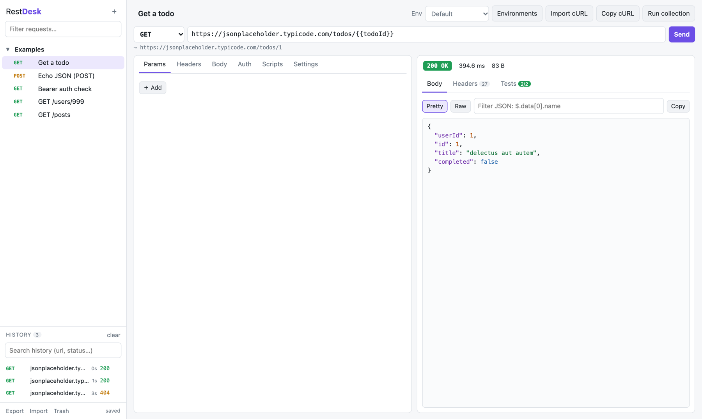
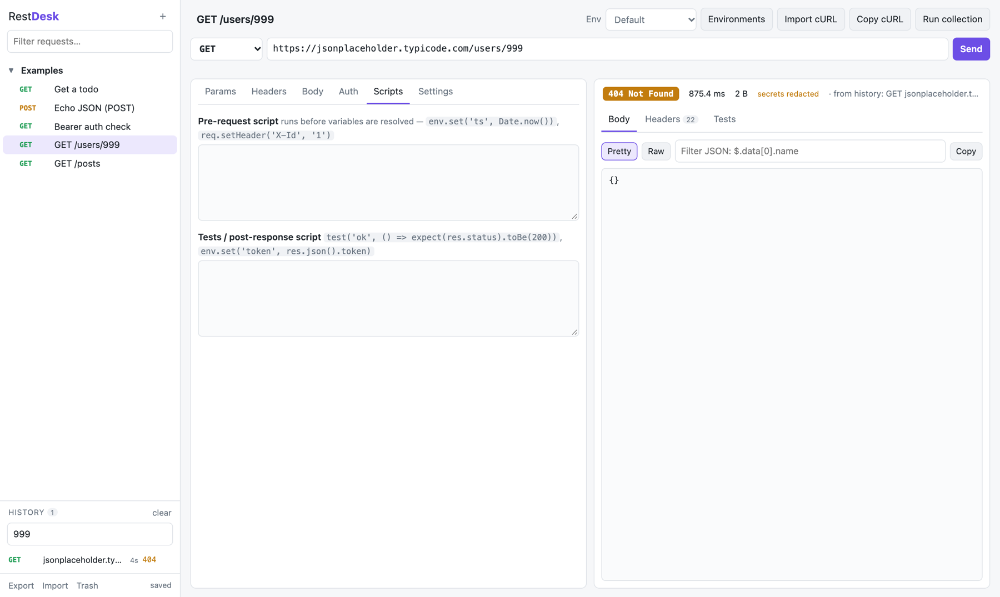
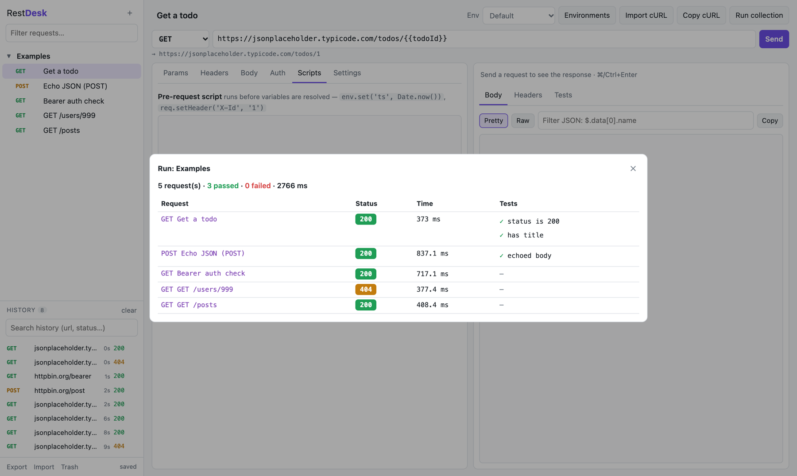
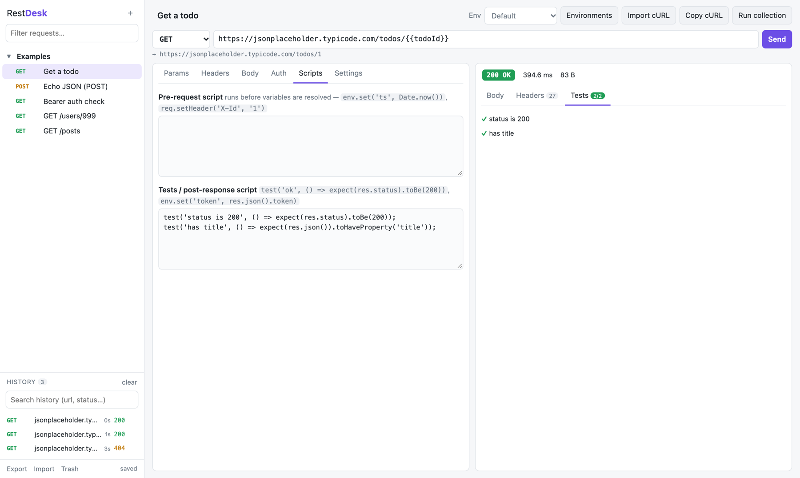
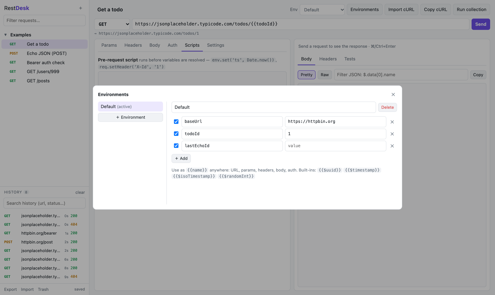
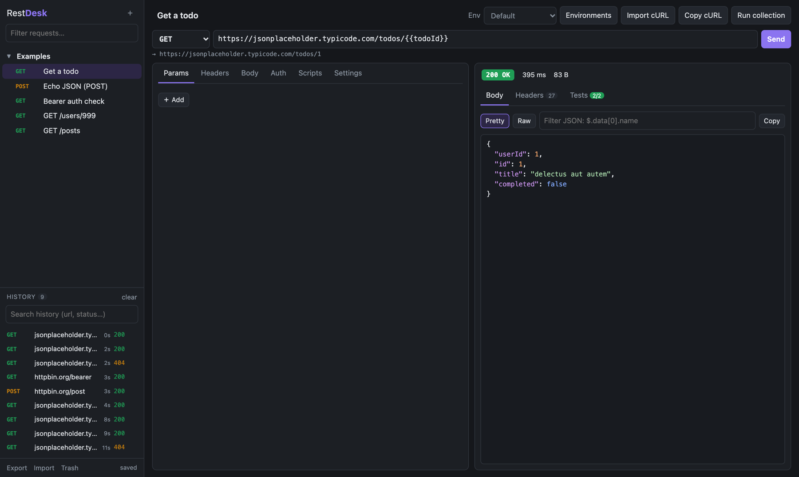

# RestDesk

[](https://github.com/shukla-surendra/restdesk/actions/workflows/tests.yml)
[](LICENSE)


A lightweight, local REST client in the spirit of Insomnia and Postman. There are no accounts, no
cloud sync, no paid tiers and no third-party dependencies. You need Python and a browser.
Your collections, environments and **every call you make, with its full response,** are saved in
one local SQLite file.



## Quick start

With [uv](https://docs.astral.sh/uv/):

```bash
uvx --from git+https://github.com/shukla-surendra/restdesk restdesk     # try it without installing
uv tool install git+https://github.com/shukla-surendra/restdesk         # or install the `restdesk` command
restdesk                                                                # opens http://127.0.0.1:8787
```

From a clone:

```bash
git clone https://github.com/shukla-surendra/restdesk && cd restdesk
uv run restdesk
```

Options: `--port 9000`, `--data ./my.db`, `--history-limit 5000`, `--no-browser`,
`--export backup.json`, `--keep-secrets-in-history`. Run `restdesk --help` for the full list.

## Why it works this way

The UI runs in your browser, and the small Python process sends the actual HTTP calls. Because the
calls don't come from the page, the browser's **CORS** limits don't apply, so you can hit
`localhost`, internal services and public APIs alike.

## Features

| Area | What you get |
|---|---|
| Requests | GET/POST/PUT/PATCH/DELETE/HEAD/OPTIONS, query-param table (paste a URL and `?a=1` is split out), header table with autocomplete |
| Body | JSON (with Beautify), text, XML, form URL-encoded, multipart (text fields) |
| Auth | Bearer, Basic, API key (header or query) |
| Environments | Multiple environments, `{{var}}` anywhere, nested vars, built-ins `{{$uuid}}` `{{$timestamp}}` `{{$isoTimestamp}}` `{{$randomInt}}` |
| Scripts | Pre-request and test scripts in plain JS: `env.set()`, `req.setHeader()`, `res.json()`, `test()` / `expect()` |
| Response | Status, time, size, pretty JSON with highlighting, raw view, JSON path filter (`$.items[*].id`), headers, image preview, gzip/deflate |
| Collections | Groups of requests: duplicate, rename, filter, and **run a whole collection** with a pass/fail report |
| History | Every call saved with its resolved request, full response, timing and test results, **with secrets redacted**. Search it, page through it, and click an entry to see the stored response again |
| Storage | One SQLite database, written in transactions, with schema migrations. Conflict-safe across tabs, Undo and a 30-day Trash for deletes, JSON export/import |
| Script sandbox | Scripts run in an isolated Web Worker with no network access and a time limit, so shared collections can't read your data |
| cURL | Import (Chrome/Firefox "Copy as cURL", `$'…'`, `-d`, `-F`, `-u`, `--json`, `-G`, …) and export |
| Per request | Timeout, follow redirects, verify TLS (for self-signed dev certs) |

## Screenshots

| Call history, with stored responses | Collection runner |
|---|---|
|  |  |
| **Test scripts** | **Environments** |
|  |  |

Dark mode follows your OS setting:



## Documentation

- [User guide](docs/user-guide.md): requests, environments, responses, history, runner, cURL, shortcuts
- [Scripting](docs/scripting.md): pre-request and test scripts, `env`, `req`, `res`, `expect`
- [Storage and history](docs/storage.md): where data lives, what is stored, limits, backups, upgrading from 0.1
- [Local HTTP API](docs/http-api.md): endpoints the UI uses, for your own tooling
- [Development](docs/development.md): uv setup, tests, layout, contributing
- [Changelog](CHANGELOG.md)

## Security notes

- The server binds to `127.0.0.1` only. It is an HTTP proxy, so don't expose it with `--host 0.0.0.0`.
- API calls require a custom `X-RestDesk` header and a local `Host`. That stops other websites open
  in your browser from using the proxy (CSRF / DNS rebinding).
- The UI is served with a strict Content-Security-Policy. User scripts run in a sandboxed worker
  with no network or page access, and are stopped after a time limit.
- History masks tokens, passwords, cookies and API keys. Your environments still hold the real
  values, so treat the database like a credentials file and leave history out of exports you share.

## Limitations

- No file uploads in multipart (text fields only), no GraphQL/gRPC/WebSocket tabs, no cookie jar
  (set a `Cookie` header yourself), and no Brotli (`br`) decoding. Don't send `Accept-Encoding: br`.
- Live responses over 50 MB are truncated. History stores up to 2 MB of each body.

## License

[MIT](LICENSE). You're free to use, modify and redistribute it, including commercially.
