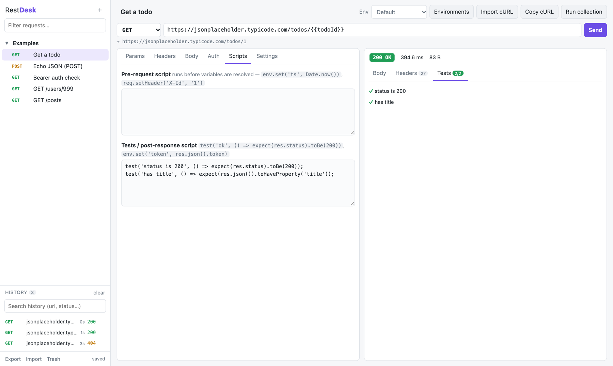

# Scripting

Each request has two optional scripts in its **Scripts** tab. They are plain JavaScript and can be
`async`, so `await` works.

## The sandbox

Scripts don't run in the RestDesk page. Each one runs in a fresh **Web Worker** that:

- can see only `env`, `req`, `res`, `test`, `expect` and `console`, with no access to the page, your
  other requests, environments or history;
- has **no network access**. `fetch`, `XMLHttpRequest`, `WebSocket`, `EventSource` and
  `importScripts` are blocked by the worker's Content-Security-Policy and also removed;
- is **stopped after a time limit** (10 s by default, set per request in *Settings → Script time
  limit*). A runaway `while (true) {}` fails that request with *script timed out* and the app keeps
  working.

So a collection someone sends you can compute, set variables and assert, but it can't read or send
your data elsewhere. A script can still put data into a `{{variable}}` that a request then sends, so
review a collection's URLs, headers and bodies before running it.

## Pre-request script
This script runs **before** `{{variables}}` are resolved:

```js
env.set('ts', Date.now());                 // available as {{ts}}
req.setHeader('X-Signature', 'abc');       // add or replace a header
req.url = req.url + '/v2';                 // req is a copy of the request
console.log('about to call', req.url);     // shown in the Tests tab
```

## Tests / post-response script

This script runs after the response arrives:

```js
test('status is 2xx', () => expect(res.status).toBeOneOf([200, 201, 204]));
test('fast enough', () => expect(res.timeMs).toBeLessThan(500));
test('has items', () => expect(res.json().items.length).toBeGreaterThan(0));
test('json content', () => expect(res.header('content-type')).toContain('json'));

// chain requests: capture a token for later requests ({{token}})
env.set('token', res.json().access_token);
```

`res`: `status`, `statusText`, `headers` (lower-cased keys), `header(name)`, `body` (text), `json()`, `timeMs`, `size`, `url`.
`expect(x)`: `toBe`, `toEqual`, `toBeTruthy`, `toBeFalsy`, `toContain`, `toMatch`, `toBeLessThan`,
`toBeGreaterThan`, `toHaveProperty`, `toBeOneOf`, plus `.not.*`. Scripts can be `async` (`await` works).

Variables set by scripts are written into the **active environment** and saved.



## Chaining requests

Write a value in one request with `env.set()` and read it as `{{name}}` in later ones. A
collection run goes top to bottom, so a login request at the top can feed a token to the rest:

```js
// "Login" request, Tests script
const { access_token } = res.json();
test('got a token', () => expect(access_token).toBeTruthy());
env.set('token', access_token);
```

Then set later requests' auth to **Bearer** with the token `{{token}}`.

## Notes

- `console.log()` output shows up in the response's **Tests** tab.
- A script that throws marks the run as failed and shows the error, and the request is still recorded in history.
- `env.unset('name')` removes a variable from the active environment.
