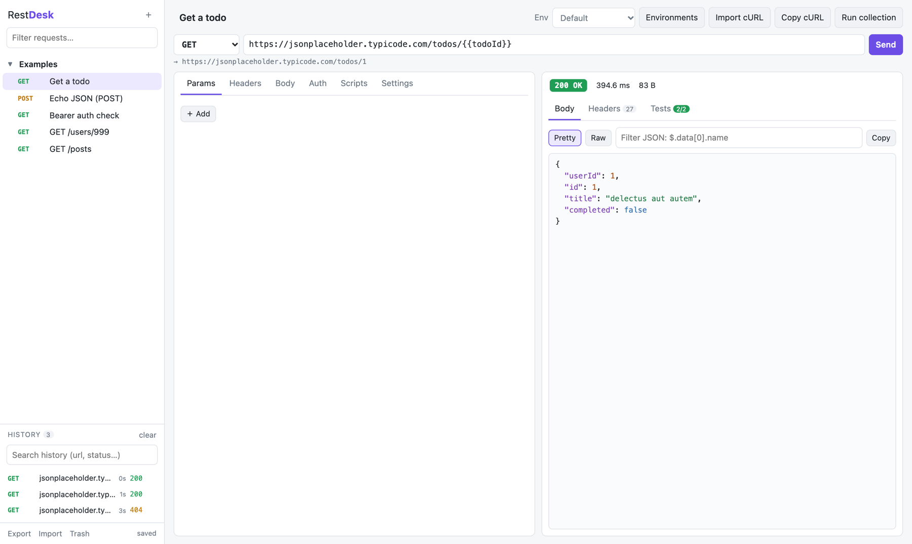
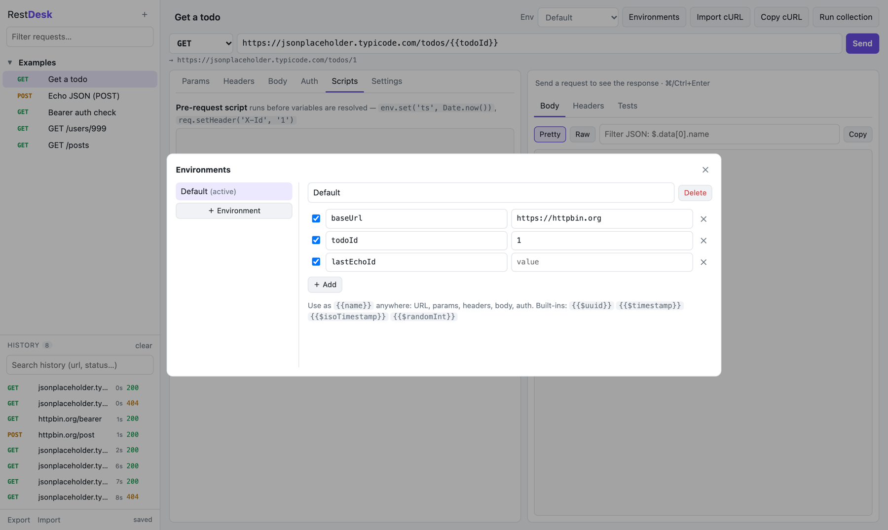
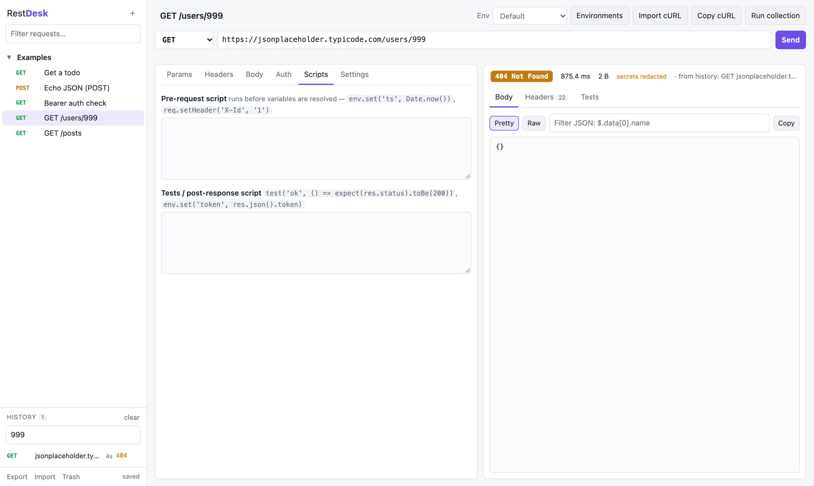
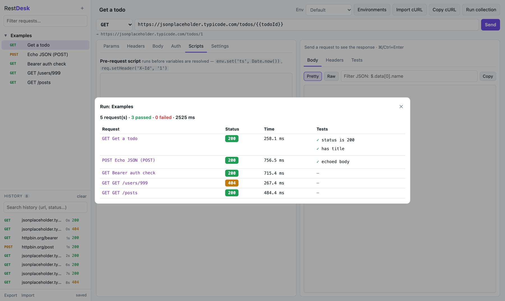
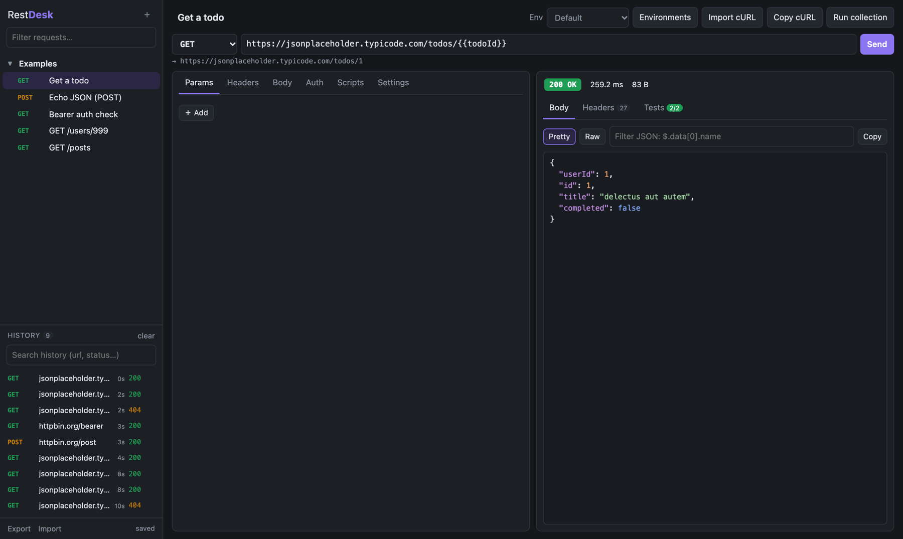

# User guide

## Starting RestDesk

```bash
uv run restdesk                       # from a clone of this repo
uv tool install git+https://github.com/shukla-surendra/restdesk   # or install the `restdesk` command
restdesk --port 9000 --no-browser
```

RestDesk opens `http://127.0.0.1:8787` in your browser. The page is the UI, and the Python process
behind it sends the real HTTP calls, so browser CORS rules don't apply.



## Requests and collections

- **＋** (next to the logo) creates a collection. Hover a collection for *add request*, *rename*,
  *delete*, or run it with **Run collection**.
- Hover a request to duplicate or delete it. **Filter requests…** searches names and URLs.
- Drag requests to reorder them, or drop one on a collection header to move it there. Collections
  can be dragged too. (Dragging is off while the filter is in use.)
- Each request keeps its last response when you switch away and back. After a restart, its most
  recent call is loaded from history (marked *last call*).
- Deleting shows an **Undo** button. Deleted items also go to **Trash** (sidebar footer) for 30 days.
- Everything autosaves. The bottom-left corner shows `saving…` / `saved`, and **⌘/Ctrl+S** saves at once.

### URL and params

Type or paste a URL. Pasting `https://api.example.com/items?page=2&q=x` moves the query into the
**Params** table, where each row can be switched off. The grey line under the URL bar shows the
final URL after variables are filled in.

### Headers

Header names autocomplete common values. Unticked rows aren't sent.

### Body

| Mode | Sent as |
|---|---|
| JSON | `application/json` (unless you set `Content-Type`). **Beautify JSON** reformats it. |
| Text / XML | raw text, `text/plain` / `application/xml` |
| Form URL-encoded | `application/x-www-form-urlencoded` from the key/value table |
| Multipart | `multipart/form-data`, text fields only |

### Auth

Bearer token, Basic (user/password) or API key (as a header or query param). Each field accepts `{{variables}}`.

### Settings

Per request: timeout, follow redirects, verify TLS certificates (turn off for self-signed dev
certificates), and the script time limit (default 10 s).

## Environments

**Environments** opens the editor. Each environment is a list of variables. Choose the active one in
the **Env** dropdown. Use `{{name}}` anywhere: URL, params, headers, body, auth. Variables can refer
to other variables.

Built-ins: `{{$uuid}}`, `{{$timestamp}}` (Unix ms), `{{$isoTimestamp}}`, `{{$randomInt}}`.

You can also use a value from another request's response, with fallbacks:
`{{@Login.body.access_token ?? token}}`. See
[Using one response in another request](#using-one-response-in-another-request).

Hover a header or param value to see what it resolves to right now.



## Using one response in another request

Write `@` and a request's name inside `{{ }}` to use a value from that request's last response.
It works in the URL, params, headers, body, auth fields and environment variables:

| Template | Value |
|---|---|
| `{{@Login.body.access_token}}` | a JSON field (dots and `[0]` work: `{{@List.body.items[0].id}}`) |
| `{{@Login.body}}` | the whole response body |
| `{{@Login.header.Location}}` | a response header (any case) |
| `{{@Login.status}}` | the status code |
| `{{@"Get user".body.id}}` | names with spaces or dots go in quotes |

**Fallbacks.** Join alternatives with `??`; the first one that has a value is used:

```
{{@Login.body.access_token ?? token}}        response first, then the env variable
{{token ?? @Login.body.access_token}}        env variable first, then the response
{{@Login.body.region ?? region ?? "eu-1"}}   ...and a fixed default at the end
```

A term has no value when the request hasn't been sent, the field isn't there, it's empty, or it
was redacted in stored history.

**Where the response comes from.** The latest response in this session. After a restart, it's the
request's most recent call in **History**. History hides secrets like tokens and passwords, so
`@Login.body.access_token` has no value after a restart. Add a fallback, such as an env variable
that Login's test script sets with `env.set('token', ...)`, or send Login again.

The name is looked up in the same collection first, then in all collections. If you rename a
request, update the templates that use it. A template that resolves to nothing is sent as written,
and you'll see *Not resolved: ...* in a message and in the **Tests** tab.

In a collection run, requests run top to bottom, so each one can use responses from the requests
above it.

## Responses

The status line shows the status code, time and size (decoded, plus on-the-wire size when it was
compressed). The tabs are:

- **Body**: pretty JSON with highlighting, or **Raw**. The filter box takes a JSON path such as
  `$.items[*].id` or `$.data[0].name`. Images show as a preview.
- **Headers**: response headers.
- **Tests**: results of the request's test script, plus `console.log` output.

## History

Every call is saved, from **Send** and from collection runs. The **History** panel lists the newest
first, with method, URL, age and status.

- **Search** matches URL, request name, method and status (`404`, `POST`, `users`…).
- **Click** an entry to see its stored response again: body, headers, timing and test results.
  If the request still matches what was sent, it is selected. If it has been edited or deleted
  since, the snapshot is restored into a `History` collection so the editor matches the response.
- **×** on hover deletes one entry, and **clear** deletes all of them.
- **Load more** pages through older entries.
- Tokens, passwords, cookies and API keys are **redacted** in stored calls. The status line says
  *secrets redacted* when you open one. See [storage.md](storage.md#secret-redaction).



See [storage.md](storage.md) for retention and size limits.

## Running a collection

**Run collection** sends every request in the current collection in order, runs each test script,
and shows a pass/fail table. Closing the dialog stops the run. Each call is also added to history.



## cURL

- **Import cURL** accepts commands from Chrome or Firefox "Copy as cURL" and handles `-X`, `-H`,
  `-d`/`--data-*`, `--json`, `-F`, `-u`, `-G`, `-k`, `-L` and `$'…'` quoting.
- **Copy cURL** copies the current request with variables filled in. The pre-request script isn't
  applied.

## Export and import

A **project file** is one JSON file with your collections, your environments with all their
variables, and the active environment. You can open it in RestDesk on any machine, web or desktop.

- **Export** (sidebar footer) lets you choose which collections and environments to include, and
  whether to add call history (off by default). Variables are exported as they are, including
  tokens and passwords, so check what's selected before you share the file.
- **Import** shows what the file contains, then:
  - **Merge** adds new collections. A collection that came from this project (same id) is
    updated, not duplicated, so importing the same file twice is safe. An environment with the same
    name gets the imported variables. *Overwrite variables that already exist* decides whether those
    replace your current values; variables that are only on your side are kept.
  - **Replace** swaps your collections and environments for the file's. Replaced collections can
    be restored from **Trash**.
- Workspace exports from older RestDesk versions import the same way.

## Keyboard shortcuts

| Keys | Action |
|---|---|
| ⌘/Ctrl + Enter | Send |
| ⌘/Ctrl + S | Save now |
| Alt + Shift + ↑ / ↓ | Move the selected request up / down |
| Tab | Indent in code boxes |

## Dark mode

RestDesk follows your OS light/dark setting.


