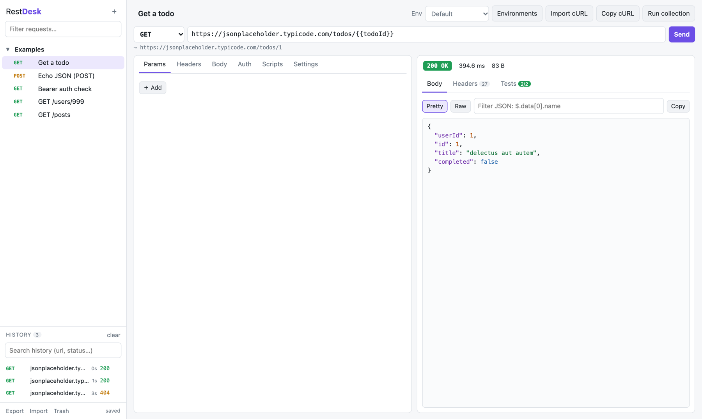
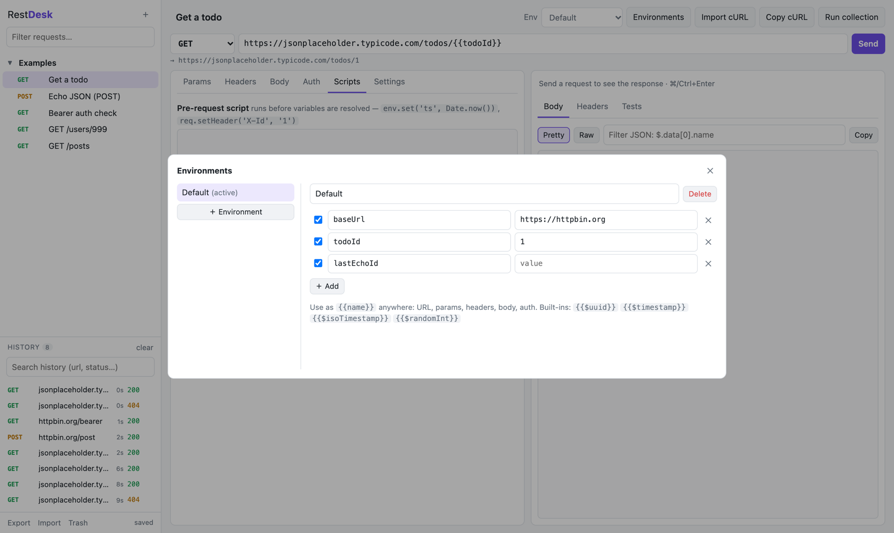
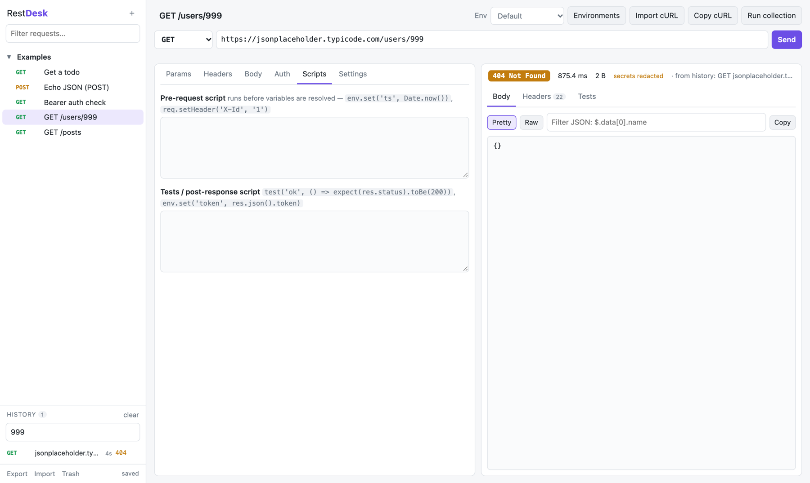
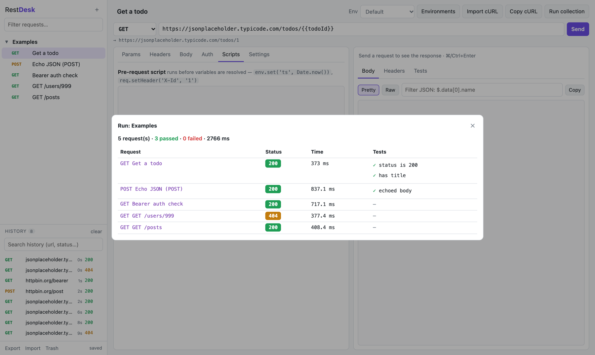
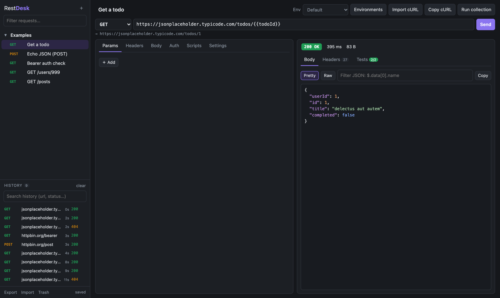

# User guide

## Starting RestDesk

```bash
uv run restdesk                       # from a clone of this repo
uv tool install git+https://github.com/shukla-surendra/restdesk   # or install the `restdesk` command
restdesk --port 9000 --no-browser
```

RestDesk opens `http://127.0.0.1:8787` in your browser. The page is the UI, and the Python process
behind it sends the real HTTP calls, so browser CORS rules don't apply.



## Requests and collections

- **＋** (next to the logo) creates a collection. Hover a collection for *add request*, *rename*,
  *delete*, or run it with **Run collection**.
- Hover a request to duplicate or delete it. **Filter requests…** searches names and URLs.
- Deleting shows an **Undo** button. Deleted items also go to **Trash** (sidebar footer) for 30 days.
- Everything autosaves. The bottom-left corner shows `saving…` / `saved`, and **⌘/Ctrl+S** saves at once.

### URL and params

Type or paste a URL. Pasting `https://api.example.com/items?page=2&q=x` moves the query into the
**Params** table, where each row can be switched off. The grey line under the URL bar shows the
final URL after variables are filled in.

### Headers

Header names autocomplete common values. Unticked rows aren't sent.

### Body

| Mode | Sent as |
|---|---|
| JSON | `application/json` (unless you set `Content-Type`). **Beautify JSON** reformats it. |
| Text / XML | raw text, `text/plain` / `application/xml` |
| Form URL-encoded | `application/x-www-form-urlencoded` from the key/value table |
| Multipart | `multipart/form-data`, text fields only |

### Auth

Bearer token, Basic (user/password) or API key (as a header or query param). Each field accepts `{{variables}}`.

### Settings

Per request: timeout, follow redirects, verify TLS certificates (turn off for self-signed dev
certificates), and the script time limit (default 10 s).

## Environments

**Environments** opens the editor. Each environment is a list of variables. Choose the active one in
the **Env** dropdown. Use `{{name}}` anywhere: URL, params, headers, body, auth. Variables can refer
to other variables.

Built-ins: `{{$uuid}}`, `{{$timestamp}}` (Unix ms), `{{$isoTimestamp}}`, `{{$randomInt}}`.



## Responses

The status line shows the status code, time and size (decoded, plus on-the-wire size when it was
compressed). The tabs are:

- **Body**: pretty JSON with highlighting, or **Raw**. The filter box takes a JSON path such as
  `$.items[*].id` or `$.data[0].name`. Images show as a preview.
- **Headers**: response headers.
- **Tests**: results of the request's test script, plus `console.log` output.

## History

Every call is saved, from **Send** and from collection runs. The **History** panel lists the newest
first, with method, URL, age and status.

- **Search** matches URL, request name, method and status (`404`, `POST`, `users`…).
- **Click** an entry to see its stored response again: body, headers, timing and test results.
  If the request still matches what was sent, it is selected. If it has been edited or deleted
  since, the snapshot is restored into a `History` collection so the editor matches the response.
- **×** on hover deletes one entry, and **clear** deletes all of them.
- **Load more** pages through older entries.
- Tokens, passwords, cookies and API keys are **redacted** in stored calls. The status line says
  *secrets redacted* when you open one. See [storage.md](storage.md#secret-redaction).



See [storage.md](storage.md) for retention and size limits.

## Running a collection

**Run collection** sends every request in the current collection in order, runs each test script,
and shows a pass/fail table. Closing the dialog stops the run. Each call is also added to history.



## cURL

- **Import cURL** accepts commands from Chrome or Firefox "Copy as cURL" and handles `-X`, `-H`,
  `-d`/`--data-*`, `--json`, `-F`, `-u`, `-G`, `-k`, `-L` and `$'…'` quoting.
- **Copy cURL** copies the current request with variables filled in. The pre-request script isn't
  applied.

## Export and import

- **Export** downloads a JSON file with collections and environments. It asks whether to add call
  history. Responses can contain tokens, so say no when you plan to share the file.
- **Import** takes that file (or a RestDesk 0.1 workspace). Choose *merge* to add it to your data, or
  *replace* to swap your collections and environments for its contents.

## Keyboard shortcuts

| Keys | Action |
|---|---|
| ⌘/Ctrl + Enter | Send |
| ⌘/Ctrl + S | Save now |
| Tab | Indent in code boxes |

## Dark mode

RestDesk follows your OS light/dark setting.


